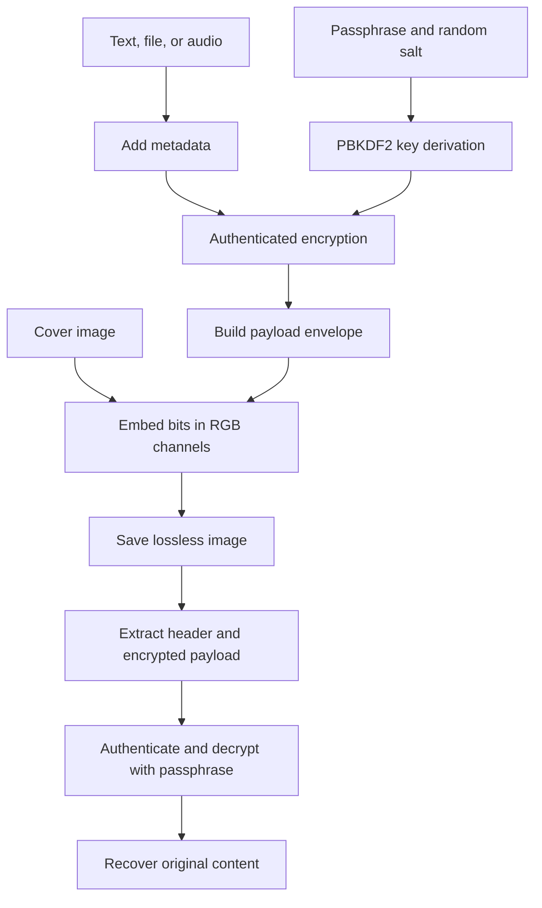

# Steg Studio

**Password-protected image steganography for text, files, and audio.**

Steg Studio hides encrypted data inside the pixels of an image using least significant bit (LSB) substitution. It includes a Python desktop application and a separate browser implementation.

Steganography conceals data inside another medium; encryption protects the contents if the hidden data is extracted. This project demonstrates image processing, binary manipulation, password-based key derivation, authenticated encryption, and graphical application development.

## Features

- Hide and recover UTF-8 text, files, and audio bytes.
- Protect content using a passphrase and authenticated encryption.
- Embed one bit per RGB channel while preserving transparency.
- Validate image capacity and reject invalid payload lengths.
- Desktop Hide data, Reveal data, session history, and light/dark themes.
- Desktop batch embedding and optional microphone recording/playback.
- Browser processing using JavaScript and the Web Crypto API.

## Implementations

| Detail | Python desktop | Browser |
| --- | --- | --- |
| Interface | CustomTkinter | HTML, CSS, JavaScript |
| Image processing | Pillow and NumPy | Browser image/canvas APIs |
| Key derivation | PBKDF2-HMAC-SHA256 | PBKDF2-HMAC-SHA256 |
| Iterations | 480,000 | 480,000 |
| Salt | 16 random bytes | 16 random bytes |
| Encryption | Fernet: AES-128-CBC and HMAC-SHA256 | AES-256-GCM |
| Format marker | `STGNEW01` | `STGWEB01` |
| Payload limit | Image capacity and available memory | 4 MiB, also limited by image capacity |

**The formats are incompatible. Recover an image with the same implementation used to create it.**

## Installation and setup

Run commands from the `steg-studio` directory inside this checkout.

### Desktop

Use Python 3.10 or later with Tk support. On Windows PowerShell:

```powershell
python -m venv .venv
.\.venv\Scripts\Activate.ps1
python -m pip install -r requirements.txt
python main.py
```

On macOS/Linux, activate the environment with `source .venv/bin/activate`. Some Linux installations need a separate system package for Tk.

| Dependency | Purpose |
| --- | --- |
| CustomTkinter | Desktop interface |
| Pillow | Image loading, conversion, and saving |
| NumPy | Pixel arrays and bit manipulation |
| cryptography | PBKDF2 and Fernet |
| psutil | Resource utilities |
| PyAudio, optional | Microphone recording and playback |

Optional audio hardware support:

```powershell
python -m pip install pyaudio
```

PyAudio may require PortAudio support. Recording and playback depend on local hardware and permissions.

### Browser

Use Node.js 22 or later:

```powershell
npm install
npm run dev
```

Open [the local application](http://127.0.0.1:4173). Web Crypto requires a secure context such as HTTPS or localhost.

Build the static distribution:

```powershell
npm run build
```

The build copies `web/` into `dist/`. The included `vercel.json` configures that build and output directory for Vercel. If deploying the enclosing repository, select `steg-studio` as the deployment root. Deployment is optional for local use.

## Usage

### Hide data

1. Open **Hide data** and select a cover image.
2. Select text, file, or audio and provide the content.
3. Enter a strong passphrase.
4. Check that the content fits the image.
5. Start embedding and save the result. The desktop offers PNG or BMP; PNG is recommended.
6. Keep the passphrase available for recovery.

### Reveal data

1. Open **Reveal data**.
2. Select the original, unedited output image.
3. Enter the passphrase used during embedding.
4. Recover the text or save the extracted file/audio.

Transfer the output as an original file. Services that resize or recompress images may destroy the payload. Desktop history lasts only for the current session.

### Classroom demonstration

Hide a short message in a PNG, recover it with the correct passphrase, and try an incorrect passphrase to demonstrate rejection. Explain that the image looks almost unchanged because each modified RGB value differs by at most one.

## Processing pipeline



### Encoding algorithm

1. Convert the content into bytes; text uses UTF-8.
2. Serialize metadata describing the content type and relevant file information.
3. Generate a random salt and derive a key from the passphrase.
4. Encrypt the metadata and content.
5. Add the format header and convert the envelope into bits.
6. Check the image capacity.
7. Replace the least significant bits of successive RGB channels.
8. Save without lossy compression.

### Decoding algorithm

1. Read RGB least significant bits and reconstruct the header.
2. Validate the format marker and payload length.
3. Extract the salt and encrypted payload.
4. Derive the key from the supplied passphrase.
5. Authenticate and decrypt the content.
6. Parse metadata and return the original bytes.

## Algorithms and cryptography

### LSB substitution

Each RGB colour channel is an 8-bit integer between 0 and 255. Replacing its rightmost bit changes its value by at most one.

```text
Original channel:  11001010 = 202
Secret bit:               1
Modified channel:  11001011 = 203
```

Embedding:

```python
new_channel = (original_channel & 254) | secret_bit
```

`& 254` clears the last bit; `| secret_bit` inserts the payload bit.

Extraction:

```python
secret_bit = channel & 1
```

Each pixel carries three bits, one each in red, green, and blue. Alpha is excluded. Both implementations use sequential embedding rather than randomized pixel positions.

### PBKDF2-HMAC-SHA256

Both implementations use 480,000 PBKDF2 iterations and a random 16-byte salt. The desktop derives 32 bytes and encodes them for Fernet; the browser derives a 256-bit AES-GCM key.

The salt is public and stored with the payload. It makes the derived key differ between operations even when a passphrase is reused. The iteration count increases the cost of password guessing. A strong passphrase remains necessary.

### Desktop encryption: Fernet

Fernet combines:

- **AES-128-CBC** for confidentiality.
- **PKCS7 padding** for block alignment.
- **HMAC-SHA256** for token authenticity and integrity.

Its 32-byte key is split into a 16-byte signing key and a 16-byte encryption key. The desktop therefore uses AES-128, not AES-256.

Metadata and content are encrypted together. Fernet adds its own framing, random IV, timestamp, authentication code, and Base64 encoding. Its timestamp is not confidential. An incorrect passphrase or damaged encrypted token causes decryption to fail.

### Browser encryption: AES-256-GCM

The browser backend uses AES-GCM with a 256-bit key, a random 12-byte IV, and a 16-byte authentication tag. The complete 40-byte header is authenticated as additional data: it remains readable, but changes cause authentication failure.

The desktop outer header is separate from Fernet authentication. Its marker and length are validated before decryption. The two implementations do not authenticate their outer headers in the same way.

## Payload formats

### Desktop: STGNEW01

| Field | Size | Meaning |
| --- | --- | --- |
| Marker | 8 bytes | ASCII `STGNEW01` |
| Token length | 8 bytes | Unsigned little-endian token length |
| Salt | 16 bytes | PBKDF2 salt |
| Fernet token | Variable | Authenticated encrypted inner payload |

The outer header is **32 bytes**. Before encryption, the inner payload is:

```text
Metadata length (4 bytes, little-endian) | Metadata JSON (UTF-8) | Content bytes
```

Metadata contains `type` (`text`, `file`, or `audio`) and a `meta` object. File metadata includes the filename and extension. Desktop audio metadata specifies WAV.

### Browser: STGWEB01

| Field | Size | Meaning |
| --- | --- | --- |
| Marker | 8 bytes | ASCII `STGWEB01` |
| Ciphertext length | 4 bytes | Unsigned big-endian length, including tag |
| Salt | 16 bytes | PBKDF2 salt |
| IV | 12 bytes | AES-GCM initialization vector |
| Ciphertext and tag | Variable | Encrypted inner payload and authentication tag |

The outer header is **40 bytes**. The inner payload contains a 4-byte big-endian metadata length, UTF-8 JSON metadata, and content bytes. Metadata includes `type` and `name`, and may include MIME information. The backend limits metadata to 4,096 bytes and content to 4 MiB.

## Capacity and performance

Raw capacity depends on pixel dimensions, not the compressed image file size:

```text
Raw capacity in bytes = floor(width × height × 3 / 8)
```

| Dimensions | Raw capacity |
| --- | --- |
| 512 × 512 | 98,304 bytes / 96 KiB |
| 1024 × 1024 | 393,216 bytes / 384 KiB |
| 1920 × 1080 | 777,600 bytes / about 759 KiB |

Actual content capacity is smaller because headers, metadata, and encryption framing consume space. Desktop Fernet also incurs padding and Base64 overhead. Its capacity estimator is conservative; the actual encrypted envelope receives a final size check before embedding.

For browser content of `B` bytes and metadata of `M` UTF-8 bytes:

```text
Envelope size = 40-byte header + 16-byte tag + 4-byte metadata length + M + B
              = 60 + M + B bytes
```

With `P` image pixels and `B` payload bytes, image-array and payload processing use approximately **O(P + B)** time and **O(P + B)** memory, excluding image codec costs and separate key derivation work. PBKDF2 work scales with its iteration count. Images and payloads are processed in memory rather than streamed.

## Project structure

```text
steg-studio/
├── main.py              # Desktop entry point and import adapter
├── app.py               # Desktop navigation, themes, history page
├── core.py              # Desktop cryptography and LSB backend
├── encrypt_tab.py       # Active hide-data interface and recording
├── decrypt_tab.py       # Active reveal-data interface
├── widgets.py           # Shared widgets and session history
├── workers.py           # Background worker utility
├── requirements.txt     # Python dependencies
├── web/
│   ├── index.html       # Browser interface
│   ├── app.js           # Browser interactions and image handling
│   ├── steg.js          # Web Crypto and LSB backend
│   └── styles.css       # Browser styling
├── scripts/
│   ├── serve.mjs        # Local server
│   └── build.mjs        # Static build
├── tests/
│   └── steg.test.mjs    # JavaScript backend tests
├── package.json         # Node scripts
└── vercel.json          # Static deployment configuration
```

The upstream GUI uses package imports despite a flat file layout. `main.py` adapts that layout at startup, so launch through this entry point. Alternate panels remain as reference; the active desktop shell uses `encrypt_tab.py` and `decrypt_tab.py`.

## Testing

Run the included JavaScript backend tests:

```powershell
npm test
```

The suite covers:

- Text, file, and audio-byte round trips, including Unicode.
- Alpha preservation and RGB changes limited to one level.
- Incorrect passphrases, ciphertext tampering, and modified salt rejection.
- Different encrypted output on repeated encryption.
- Missing markers, invalid lengths, small images, and capacity overflow.
- Exact-capacity embedding/extraction.
- Empty passphrases and oversized content.

These backend tests do not replace browser interaction, image export/reload, or desktop hardware testing. There is no equivalent automated Python backend test suite included. For manual validation, check text/file recovery, wrong passphrases, oversized content, PNG export/reload, transparency, and optional microphone/playback behavior.

## Limitations

- Sequential LSB embedding and the fixed marker can reveal that hidden data is present. Undetectability is not guaranteed.
- JPEG conversion, resizing, cropping, filtering, and recompression can corrupt payload bits.
- There is no error correction. Authentication detects invalid encrypted content but cannot repair it.
- Someone holding the image can attempt offline passphrase guesses.
- Forgotten passphrases have no application recovery mechanism.
- Large payloads and audio recordings can exceed image capacity.
- Large images and files consume memory because processing is not streamed.
- Desktop, browser, and omitted original upstream backend formats are not interchangeable.
- Preservation of EXIF, colour profiles, and other source-image metadata is not guaranteed.
- This educational project has not undergone an independent security audit.

Local processing avoids a required server upload for embedding and recovery. It does not protect against a compromised device or malicious application code.

## Possible future improvements

The following are proposed extensions, not implemented features:

- Error-correcting codes for limited damage recovery.
- Keyed selection of embedding positions.
- A shared, versioned desktop/browser payload format.
- PSNR and SSIM measurements for image quality.
- Statistical evaluation of payload detectability.
- Automated Python backend and end-to-end interface tests.
- Improved memory handling for large images and files.

## Acknowledgments

The desktop interface is based on [ES-KH2/steg-studio](https://github.com/ES-KH2/steg-studio). The upstream files supplied the GUI but omitted its core backend. This version supplies an import-layout adapter and replacement backend using `STGNEW01`, plus a separate JavaScript implementation using `STGWEB01`.

LSB steganography, PBKDF2, AES, Fernet, and HMAC are established techniques. This project integrates them into an application rather than introducing a new cryptographic algorithm. Preserve applicable upstream attribution and licensing terms when redistributing the project.
